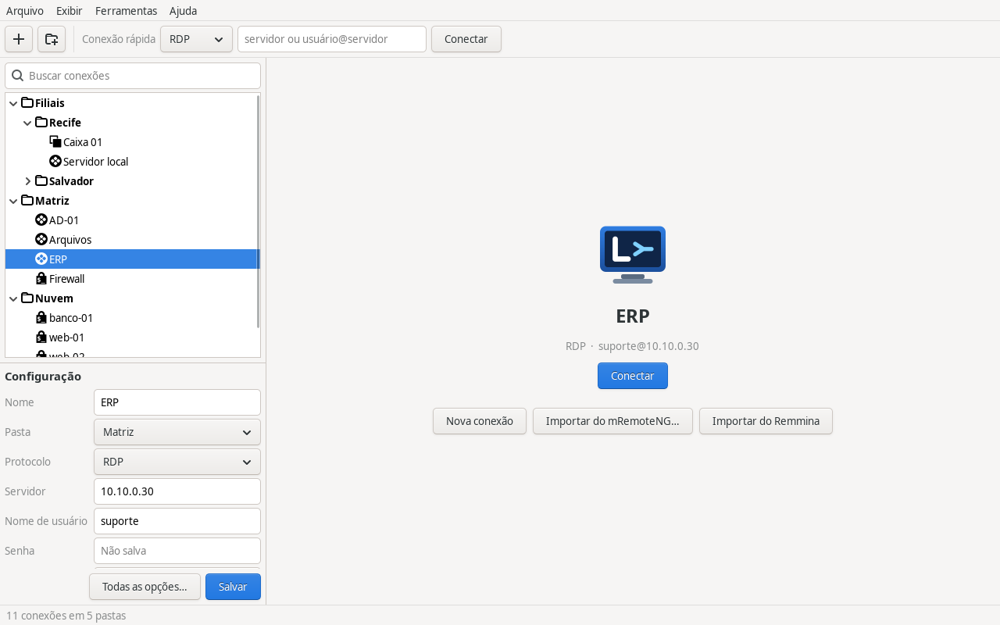
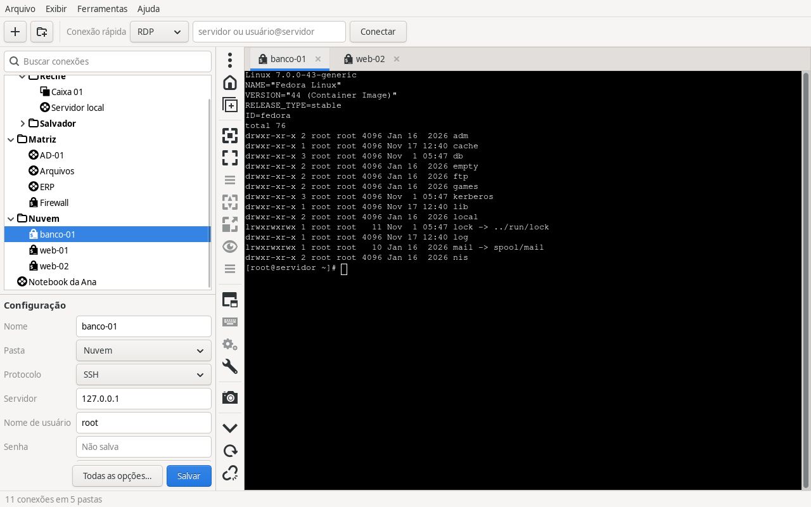
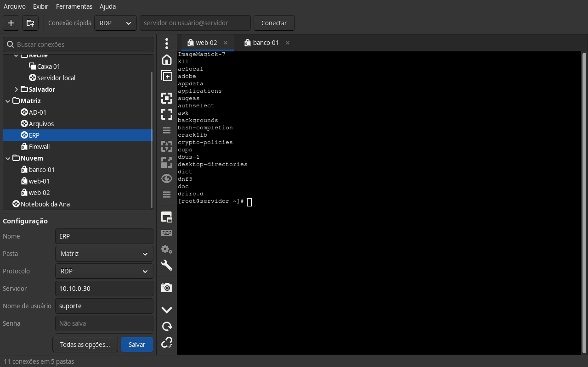
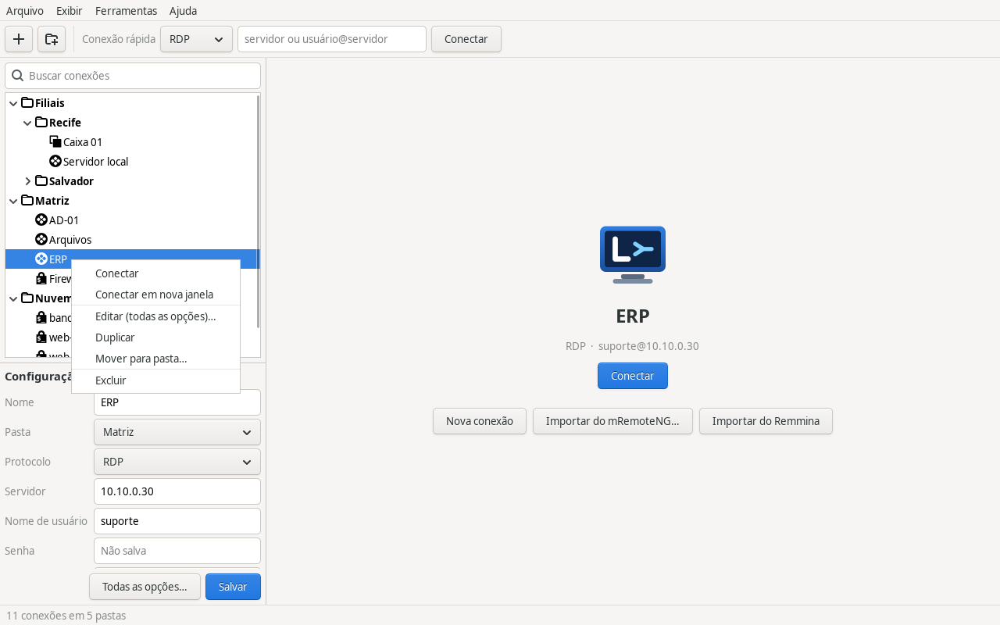
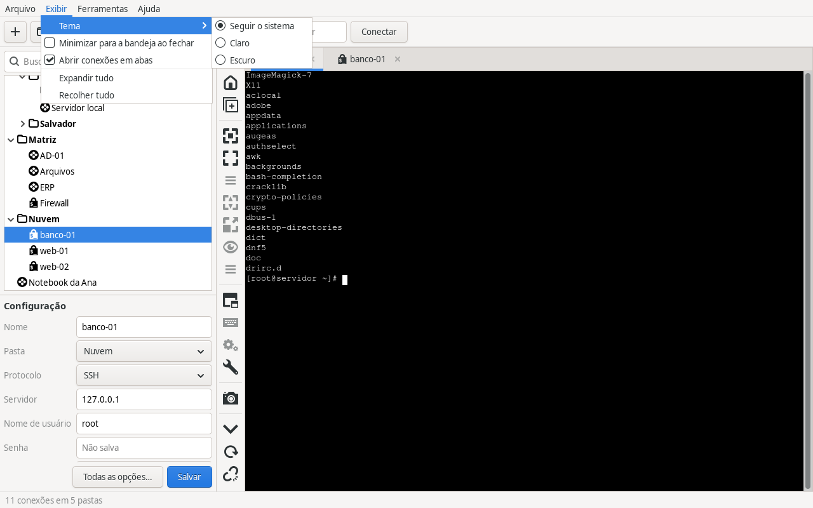

<p align="center">
  
</p>

<h1 align="center">lRemote</h1>

<p align="center">
  <b>O jeito do mRemoteNG de organizar conexões, agora no Linux</b>: árvore de pastas, abas e importação do mRemoteNG.<br>
  Feito sobre o motor do Remmina, com RDP, VNC, SSH e SPICE.
</p>

<p align="center">
  
</p>

<p align="center">
  <i>Prints com dados fictícios. A interface é a do app; servidores e nomes são ilustrativos.</i>
</p>

---

## O que é

O lRemote é um gerenciador de conexões remotas para quem vem do Windows e do mRemoteNG. As conexões ficam numa árvore de pastas à esquerda, com as configurações principais logo abaixo, e cada sessão abre numa aba da própria janela. Por baixo, quem conecta é o motor do [Remmina](https://remmina.org), com todos os protocolos e opções dele.

Este é um **projeto de estudo de UI/UX**: a janela foi redesenhada sobre o Remmina para praticar fluxo de trabalho, abas, migração de dados e empacotamento.

Versão atual: **0.1.0-14** · [Releases](https://github.com/mpjsilva/lRemote/releases) · [Desenvolvimento](#para-desenvolvedores)

## Principais diferenciais

| | Remmina | lRemote |
|---|---|---|
| **Organização** | Lista de perfis com grupos | Árvore de pastas como no mRemoteNG, com busca e painel **Configuração** embaixo |
| **Sessões** | Uma janela por conexão (ou agrupadas) | Abas na janela principal, ou cada conexão na sua janela, como preferir |
| **Migração** | Sem importação do mRemoteNG | Importa o `confCons.xml` do mRemoteNG, com pastas, protocolos e senhas (AES-GCM e formato antigo, senha mestra padrão ou própria) |
| **Bandeja** | Ícone com a lista de perfis | **Minimizar para a bandeja ao fechar**; menu com Restaurar, Conexões, Verificar atualizações e Sair |
| **Atualização** | Pelo gerenciador da distribuição | **Ajuda › Verificar atualizações** baixa a release nova do GitHub e instala (dnf ou apt), depois reinicia |
| **Pacote** | Depende das bibliotecas da distribuição | RPM e .deb autocontidos: só a biblioteca C e os drivers de vídeo vêm do sistema |

E mais:
- **Tema claro, escuro ou do sistema**, em **Exibir › Tema**.
- **Português do Brasil** completo, além do inglês.
- **Backup das configurações** (**Arquivo › Exportar configurações**), sem as senhas.
- **Importar do Remmina**: traz os perfis de um Remmina já instalado.
- **Conectar em nova janela**, no botão direito de uma conexão, para quem prefere o jeito do Remmina. O modo inteiro também pode ser trocado em **Exibir › Abrir conexões em abas**.

## Telas

| | | |
|:-:|:-:|:-:|
| <br>Árvore, configuração e página inicial | <br>Sessões SSH em abas | <br>Tema escuro |
| <br>Botão direito numa conexão | <br>Menu Exibir: tema e abas | |

## Instalação

Baixe o pacote na página de [Releases](https://github.com/mpjsilva/lRemote/releases). Os dois são de 64 bits (x86_64) e trazem as bibliotecas dentro, então não precisam de nada além do sistema.

### Fedora 44 (RPM)

```bash
sudo dnf install ./lremote-0.1.0-14.fc44.x86_64.rpm
```

### Ubuntu 24.04, Debian 13 ou mais novos (.deb)

```bash
sudo apt install ./lremote_0.1.0-14_amd64.deb
```

Depois, abra o **lRemote** pelo menu de aplicativos ou rode `lremote` no terminal. Para ver a versão instalada: `lremote --version`.

> O plugin de páginas web (protocolo WWW) usa o WebKitGTK do sistema. Sem ele (`webkit2gtk4.1` no Fedora, `libwebkit2gtk-4.1-0` no Ubuntu e no Debian), esse protocolo some e o resto funciona normalmente.

> Ao atualizar à mão, feche o lRemote antes, inclusive o da bandeja: `pkill -f lremote-bin`.

## Migrar do mRemoteNG

1. No Windows, copie o arquivo de conexões do mRemoteNG. Normalmente é `%APPDATA%\mRemoteNG\confCons.xml`.
2. No lRemote, use **Arquivo › Importar do mRemoteNG…** e escolha o arquivo.
3. Se o arquivo tiver senha mestra própria, o lRemote pede a senha. Sem ela, usa a senha padrão do mRemoteNG.

Pastas viram pastas da árvore, e cada conexão RDP, VNC, SSH ou HTTP(S) vira um perfil. Conexões com o mesmo nome na mesma pasta são mantidas lado a lado, sem sobrescrever.

## Controles principais

| Onde | Ação | O que faz |
|---|---|---|
| Árvore | Clique duplo / Enter | Conecta numa aba |
| Árvore | Botão direito | Conectar, Conectar em nova janela, Editar, Duplicar, Mover, Apagar |
| Árvore | Delete / F2 | Apaga ou renomeia |
| Janela | Ctrl + N / Ctrl + Shift + N | Nova conexão / nova pasta (fora de uma sessão) |
| Janela | Ctrl + , | Preferências |
| Sessão | Ctrl direito (tecla de atalho) | Comandos da sessão do Remmina, como Ctrl direito + F para tela cheia |
| Bandeja | Botão do meio | Restaura a janela |

Com o foco numa sessão, as teclas vão para o computador remoto: Ctrl + N, Alt + F e as outras não abrem os menus do lRemote.

## Privacidade

- O lRemote não tem telemetria nem servidor do projeto. As conexões vão direto do seu computador para os seus servidores.
- Perfis e senhas ficam em `~/.local/share/lremote` e `~/.config/lremote`. As senhas vão para o chaveiro do sistema quando há um disponível.
- O único acesso à internet além das conexões é o **Verificar atualizações**, que consulta a API do GitHub só quando você pede.
- O backup de configurações não leva senhas.

## Para desenvolvedores

- `src/lremote_window.c`: janela principal (árvore, painel Configuração, página inicial, abas embutidas, menus).
- `src/lremote_mremoteng.c`, `src/lremote_crypto.c`: importação do mRemoteNG e decifragem das senhas.
- `src/lremote_update.c`: verificação e instalação de atualizações pelas releases do GitHub.
- `src/rcw.c`: janela de sessão do Remmina, adaptada para viver dentro da janela principal.
- `src/remmina_icon.c`: ícone e menu da bandeja.
- `packaging/rpm/`: spec do RPM e `bundle-libs.sh`, que copia as bibliotecas para dentro do pacote.
- `packaging/deb/build-deb.sh`: o mesmo para o .deb.
- `po/pt_BR.po`: tradução.

```bash
# build de desenvolvimento (Ubuntu 24.04 ou contêiner com as dependências do Remmina)
cmake -S . -B build -DWITH_FREERDP3=ON -DWITH_GVNC=OFF -DWITH_X2GO=OFF
cmake --build build -j$(nproc)

# .deb autocontido em dist/
bash packaging/deb/build-deb.sh 11 dist

# RPM: rpmbuild -ba packaging/rpm/lremote.spec (num Fedora, com o tarball do código em SOURCES)
```

## Limitações conhecidas

- Testado com SSH e RDP (aba, janela separada, tela cheia, teclado) contra servidores de teste em contêiner (OpenSSH e FreeRDP shadow). VNC e SPICE ainda não foram testados dentro das abas.
- Com as sessões dentro da janela principal, a captura de teclado do Remmina (que prende atalhos do sistema como Alt + Tab) fica desligada. Para isso, use **Conectar em nova janela** ou a tela cheia.
- O menu da bandeja não foi conferido numa área de trabalho real; em ambientes sem bandeja (GNOME sem extensão), a opção de minimizar para a bandeja não tem efeito.
- O pacote .deb foi testado em contêineres Ubuntu 24.04 e Debian 13, não numa instalação com área de trabalho.
- Só x86_64.

## Agradecimentos

O lRemote só existe porque outros projetos livres fazem o trabalho pesado por baixo:

**Base do app**
- **[Remmina](https://remmina.org)** (GPL v2 ou posterior): todo o motor de conexões, os plugins de protocolo e a janela de sessão.
- **[GTK](https://gtk.org)**: a interface.

**Protocolos**
- **[FreeRDP](https://www.freerdp.com)** (Apache 2.0): RDP.
- **[LibVNCServer](https://libvnc.github.io)** (GPL v2): VNC.
- **[libssh](https://www.libssh.org)** (LGPL) e **[VTE](https://gitlab.gnome.org/GNOME/vte)** (LGPL): SSH e terminal.
- **[spice-gtk](https://gitlab.freedesktop.org/spice/spice-gtk)** (LGPL): SPICE.

**Inspiração**
- **[mRemoteNG](https://mremoteng.org)** (GPL v2): o fluxo de trabalho e o formato do `confCons.xml` que o lRemote importa.

**Aviso:** o lRemote não é afiliado ao Remmina nem ao mRemoteNG. Os nomes são dos respectivos projetos.

## Licença

O lRemote é distribuído sob a [GNU GPL v2 ou posterior](LICENSE), como o Remmina, com a exceção para OpenSSL descrita em [COPYING](COPYING). O README original do Remmina está em [README.remmina.md](README.remmina.md).

Feito por [mpjsilva](https://github.com/mpjsilva), com a ajuda do Claude (Anthropic) no desenvolvimento.
